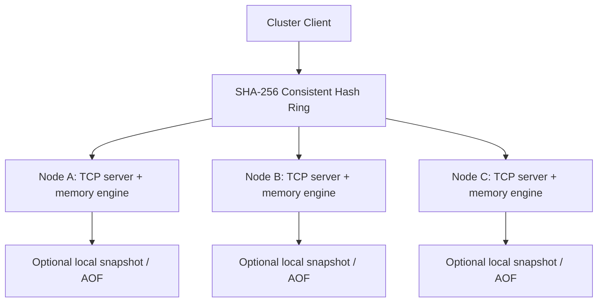

# Distributed Cache

A Redis-inspired distributed in-memory cache built from scratch in Python.

This is an educational distributed-systems project and is **not protocol compatible with Redis**.
It uses no external cache, database, membership service, or storage engine. Python 3.12+ is required.

## Features

- Binary-safe keys and values over an asyncio TCP server, bound to localhost by default.
- Conditional SET, TTL, lazy and active expiration, signed 64-bit atomic counters.
- Approximate memory accounting, real LRU eviction, and noeviction mode.
- Versioned framing, bounded inputs, ordered pipelines, stable structured errors.
- Sync and async clients with bounded lazy connection pools and explicit timeouts.
- Atomic snapshots, checksummed append-only logs, partial-tail recovery, restart tests.
- SHA-256 consistent hashing, virtual nodes, smart sync/async cluster clients.
- Health probes with failure/success thresholds and explicit unavailable-owner errors.
- Maintenance-window rebalance planning and verified copy-before-delete migration.
- Statistics, rolling latency metrics, Typer CLI, reproducible local benchmarks.

Replication, replica reads, automatic promotion, and consensus are **not implemented**.
Replica placement can be calculated for learning purposes, but does not create stored replicas.
Configurations requesting a replication factor other than one are rejected.

## Architecture



Clients own a static topology. Servers are independent and accept any valid key; they do not
enforce ownership or discover topology. All clients must use the same node IDs and vnode count.
Changing a config alone does not move data. Use the migration procedure below.

## Single Node Architecture

`asyncio.start_server` accepts persistent TCP connections. The framing layer reads exactly a
four-byte header and the declared body. The codec validates a versioned JSON envelope and decodes
tagged base64 byte strings. An explicit dispatcher calls short engine operations under one
`asyncio.Lock`. Engine methods contain no awaits and require a single owner; use clients for
concurrent application access rather than sharing an engine across threads.

Socket reads, writes, and backpressure occur outside that lock. OrderedDict stores entries in
recency order, a generation-checked min-heap schedules expiration, and separate integer IDs allow
bounded scans without sorting or copying the whole dictionary. Persistence I/O runs through
`asyncio.to_thread` while the operation lock protects the state/checkpoint. Consequently disk
latency can delay other commands on that node. This is a correctness-first implementation.

## Cache Commands

| Command | Arguments / result |
| --- | --- |
| PING | `PONG` |
| GET | key → bytes or JSON null for missing |
| SET | key, value, optional ttl in seconds, nx, xx → boolean |
| DELETE | key → whether a live key existed; idempotent |
| EXISTS | key → boolean |
| TTL | key → remaining fractional seconds; -1 persistent, -2 missing |
| EXPIRE | key, positive ttl seconds → boolean |
| PERSIST | key → true if a live key exists, clears expiration |
| INCR / DECR | key → signed 64-bit counter, missing starts at zero |
| INCRBY / DECRBY | key, integer amount → updated counter |
| MGET | keys → values in the original order, including nulls |
| MSET | items (pairs of bytes) → success booleans; sequential, can partially succeed |
| STATS / INFO | node statistics and bounded rolling latency averages |
| SCAN | cursor=0, count=100 → next cursor and binary keys |
| FLUSH | deletes all entries on one node; CLI requires `--yes` |
| SNAPSHOT | save to the configured fixed snapshot path |
| EXPORT / IMPORT | administrative transfer of key, value, absolute expiration |

`NX` and `XX` are mutually exclusive booleans. SET replaces any previous TTL unless a new TTL is
specified. Counter changes preserve the current TTL. Values must match `-?[0-9]+` and fit in a
signed 64-bit integer; overflow fails without changing the value. TTL must be finite, positive,
and at most ten years. Zero and negative TTLs are rejected rather than interpreted as DELETE.

MSET validates pair shapes first but memory failures may leave earlier pairs applied. Those
changes are still journaled when AOF is enabled. There is no rollback API.

## TTL and Expiration

Runtime deadlines use `time.monotonic()`. GET and all existence-sensitive operations remove an
expired entry before returning a result. An active task wakes every 50 ms and processes at most
256 due heap records. GET never returns a value that was expired at its lookup point, even when
the active task has a backlog.

Heap records are `(deadline, generation, key)`. SET and TTL changes increment the generation, so
old heap records cannot delete a newer value. Stale heap metadata is compacted when it exceeds
`max(64, 2 * live_entries)`; occasional O(n) rebuilds trade bounded metadata for amortized work.
The active task does not repeatedly scan all entries.

Persisted and transferred deadlines are absolute `time.time()` timestamps. Recovery reconstructs
a fresh monotonic deadline from the remaining wall-clock lifetime and skips expired records.
Raw monotonic values are never persisted. Clock adjustments across restart or between migration
hosts can affect recovered TTL; clocks should agree. Active expiration may lag by several ticks.

## Memory Management

Accounted bytes are `len(key) + len(value) + 128` per entry. This is an application-level estimate,
**not exact Python object memory or process RSS**. Socket buffers, decoding buffers, dictionaries,
scan metadata, temporary snapshots, and the interpreter require additional memory.

The default budget is 64 MiB. KB/MB/GB and KiB/MiB/GiB all mean powers of 1024. Invalid and zero
limits fail cleanly. Replacement subtracts the old entry before determining required space.
An entry larger than the entire budget is rejected before evicting anything. `noeviction` rejects
insufficient-space writes and preserves existing live values. Expired entries may still be removed.
Recovery uses noeviction internally and fails startup if configured limits cannot hold the data.
Use a separate data directory per node and only one process per directory.
Keep the persistence mode stable for an existing directory; export or migrate data to a fresh
directory before switching modes, rather than mixing an old log with unrelated snapshots.

## LRU

OrderedDict gives O(1)-style lookup, recency movement, and oldest-entry eviction. GET/MGET and
successful SET/counter changes update recency. EXISTS, TTL, SCAN, EXPORT, EXPIRE, and PERSIST do not.
Evicting k entries costs O(k); there is no full-cache sort. Heap insertion is O(log n), with the
occasional metadata compaction described above. LFU and CAS are future work.

## Persistence

Start with `--persistence none|snapshot|aof|snapshot+aof` and `--data-dir cache-data/node-a`.
Default is `none`. Persistence files are local, trusted administrative inputs, not network paths.

Snapshots contain an eight-byte magic/version, eight-byte big-endian body length, UTF-8
JSON/base64 body with sequence number, record count, entries and wall-clock deadlines, followed
by a SHA-256 checksum. The binary container uses no executable serialization. A temporary file
is flushed and fsynced before `os.replace`. POSIX also fsyncs the containing directory; Windows
does not use directory fsync. SNAPSHOT and graceful shutdown save snapshots when configured.
An interrupted replacement leaves the previous valid snapshot intact. Corruption fails startup.

AOF begins with the same magic/version. Each record has an eight-byte big-endian length,
JSON/base64 transaction body, and SHA-256 checksum. Records contain monotonically increasing
sequence numbers and **resulting state changes**, including overwritten entries, evictions,
deletions and deadlines, rather than re-executing counter commands. FLUSH has a compact clear
record. Changed keys are removed together before restored values are applied, avoiding accidental
extra evictions from replay order. A record is limited to 32 MiB.

`--fsync always` (default) flushes and calls fsync before acknowledging an AOF mutation.
`--fsync no` flushes to the OS but does not fsync; an OS or power failure can lose acknowledged
writes. There is no every-second mode. Actual durability still depends on OS/filesystem/hardware.
In-memory mutation precedes journal append; an append error returns PERSISTENCE_ERROR and the
node refuses subsequent commands until restart. The failed operation's outcome is uncertain.
Snapshot-only changes are durable only at the last successful snapshot.

Combined recovery loads the snapshot checkpoint and applies only higher AOF sequences. A partial
final length/body/checksum is truncated, preserving prior complete records and allowing new appends.
A complete checksum mismatch, invalid record length, or incompatible magic/version fails startup;
the implementation does not guess that corruption is safe to discard. AOF is not compacted or
rewritten in this release, so provision disk space and monitor growth. GET recency and statistics
are not journaled; LRU order after AOF recovery is reconstructed from mutations.

## TCP Protocol

Every frame is a four-byte **unsigned big-endian** payload length followed by that many UTF-8 JSON
bytes. Length must be 1..8 MiB and is checked before body allocation. TCP packet boundaries have
no meaning: `readexactly` supports fragmentation and coalescing. Commands on one connection execute
in received order. Clients can transmit multiple framed requests before reading responses.

```json
{"version":1,"request_id":"42","command":"SET","args":{"key":{"$bytes":"aGVsbG8="},"value":{"$bytes":"d29ybGQ="},"ttl":60}}
```

```json
{"version":1,"request_id":"42","ok":true,"data":true}
```

```json
{"version":1,"request_id":"42","ok":false,"error":{"code":"OUT_OF_MEMORY","message":"Insufficient accounted memory"}}
```

All binary fields use exactly `{"$bytes":"<strict base64>"}`. GET missing is `data: null`;
there is no ambiguous sentinel byte string. Request IDs are strings of at most 128 characters.
Malformed frames/envelopes receive an error with null ID and close the connection. Command errors
with a valid envelope retain its ID and leave the connection usable. The server limits active
connections (default 256) and the time to receive a frame or drain output (default 30 seconds).

Key and value limits default to 4 KiB and 1 MiB. They are checked after bounded frame decoding,
so transient base64/JSON allocation can exceed entry accounting. MGET is limited to 1,000 keys and
4 MiB of raw result values; MSET to 1,000 pairs and the frame limit. Pipelines are limited to 1,000
commands and 8 MiB of encoded requests. Clients collect pipeline responses in memory; use bounded
batches for large values. Invalid JSON, invalid base64, and nonfinite numbers are rejected.

Stable error codes include INVALID_REQUEST, UNSUPPORTED_VERSION, UNKNOWN_COMMAND, KEY_TOO_LARGE,
VALUE_TOO_LARGE, OUT_OF_MEMORY, INVALID_INTEGER, INVALID_TTL, PERSISTENCE_ERROR, NODE_UNAVAILABLE,
POOL_TIMEOUT, CLIENT_CLOSED, INVALID_RESPONSE, and MIGRATION_FAILED. WRONG_NODE is not implemented.

## Consistent Hashing

SHA-256 maps keys to unsigned 256-bit positions. Each physical node has 128 virtual positions by
default, hashing the UTF-8 bytes of `"<UTF-8 byte length of ID>:<node ID>:<vnode index>"`. Positions
are sorted once; `bisect_left` chooses the first clockwise owner in O(log V). Lookups wrap around
the end of the ring. Node IDs are stable identities; endpoint changes do not change their hashes.

```text
              A:0
          /         \
       C:4          B:7  <-- key hashes here: next clockwise vnode owns it
          \         /
              A:8
```

## Why Virtual Nodes?

A physical node appears at many locations so one unlucky position is less likely to own an
excessive arc. Balance is statistical, not perfect. The deterministic verification uses 10,000
`key:0` through `key:9999` keys and 128 vnodes per node. Measured counts are node-a **3,392**,
node-b **3,782**, node-c **2,826**. Adding node-d moves **27.73%** of keys, all to node-d;
SHA-256 modulo node-count mapping moves **75.16%**. Reproduce with `python scripts/verify.py`.

## Cluster Client

ClusterClient and AsyncClusterClient route each key directly to its owner and retain bounded
per-node pools. MGET groups keys by node, sends groups concurrently, and reconstructs the original
order. MSET routes sequential writes and is not globally atomic. Large MGET groups must be split
to respect node result limits. Administrative commands operate through per-node clients.

## Consistency Model

One configured owner serves each key. The server serializes individual node operations, including
counter read/modify/write, with its engine lock. There are no distributed transactions, global
snapshots, consensus, or safe automatic leader election. Even single-node MSET can partially
succeed. Writes on different nodes can complete independently. Client timeout/disconnection does
not imply a write was rejected; its result may be uncertain. Clients never retry commands
automatically, avoiding accidental double increments. A subsequent explicit call can reconnect.

## Failure Handling

`check_health()` explicitly probes every node with PING. Three consecutive transport failures
mark a node unavailable; one or two mark it suspected. Two consecutive successful observations
mark it healthy. Routed successful operations also count as observations; transport failures count
against that owner. Health is advisory: it never removes nodes from the ring or silently reroutes
writes. There is no background membership service. Run probes periodically in the application if
desired; multi-key batches do not themselves update the advisory health map.

When an owner is unavailable, reads and writes return NODE_UNAVAILABLE. There are no stored
replicas or fallback reads, so data on that owner remains inaccessible until it returns or is
restored from local persistence. A partition is not solved by changing a health flag.

## Rebalancing

1. Start every destination with `--eviction noeviction` and adequate memory/disk capacity.
2. Pause **all application writes** and keep them paused for the entire plan/migration/verification.
3. Keep old nodes reachable. Create a separate new topology; retain endpoints for existing IDs.
4. Run a dry plan (the default):
   `distributed-cache cluster rebalance --old examples/cluster.toml --new cluster-new.toml`.
5. Execute with the same arguments plus `--execute --writes-paused`.
6. Verify data using clients with the new config, then distribute that config to applications.
7. Only after verification, stop removed/drained nodes and resume writes.

The planner scans old owners in bounded pages and holds the movement plan in memory. Migration
exports each live value and its absolute deadline, imports it at the new owner, reads it back to
verify equality, then deletes the old copy. Noeviction destinations prevent later copies from
silently evicting earlier copies. A failed copy/verification leaves that source intact. The process
is incremental: failure may leave some keys already moved, so remain in maintenance mode and rerun
the plan. A network failure can leave duplicate copies. New target topology must be used after
completion. There is no online dual-write protocol or persistent migration coordinator.
Expired keys can disappear during migration; an expiration during verification can stop the run
safely. Transfer acknowledgement is only as durable as each node's configured persistence mode.

SCAN examines at most `count` integer ID slots per page (1..1,000). Empty pages can have a nonzero
cursor because IDs are sparse after deletion. Continue until cursor zero. Concurrent writes may
cause omissions/duplicates and invalidate an old traversal; no global ordering or snapshot is
promised. FLUSH does not reset the ID high-water mark. Maintenance scans may cross many empty slots.

## Installation

```sh
python -m venv .venv
```

Windows PowerShell:

```powershell
.venv\Scripts\Activate.ps1
```

Linux/macOS:

```sh
source .venv/bin/activate
```

```sh
python -m pip install -e ".[dev]"
distributed-cache --help
distributed-cache --version
```

The only direct runtime dependency is **Typer**, for CLI parsing/help; storage, framing, networking,
hashing, persistence and routing use the standard library. Development dependencies are pytest,
pytest-asyncio (async integration tests), and Ruff (lint/format). Hatchling builds the package.

## Quick Start

```sh
distributed-cache server start --node-id node-a --port 7001 --max-memory 64MB
```

In another terminal:

```sh
distributed-cache ping --port 7001
distributed-cache set hello world --ttl 60 --port 7001
distributed-cache get hello --port 7001
distributed-cache ttl hello --port 7001
distributed-cache incr views --port 7001
distributed-cache stats --port 7001
```

CLI results are JSON; binary results remain tagged base64 so arbitrary bytes are lossless.
Use Python clients for convenient raw bytes. Stop foreground nodes with Ctrl+C.

Persistence-enabled example:

```sh
distributed-cache server start --port 7001 --persistence snapshot+aof --fsync always --data-dir cache-data/node-a
distributed-cache snapshot --port 7001
```

## Cluster Example

Run in three terminals; `examples/cluster.toml` already describes these endpoints:

```sh
distributed-cache server start --node-id node-a --port 7001 --eviction noeviction
distributed-cache server start --node-id node-b --port 7002 --eviction noeviction
distributed-cache server start --node-id node-c --port 7003 --eviction noeviction
```

```sh
distributed-cache cluster status --config examples/cluster.toml
distributed-cache cluster hash user:42 --config examples/cluster.toml
```

Create a new config by copying the old one and adding a `[[nodes]]` entry with ID node-d and
port 7004. Start that server before planning a rebalance. Removal uses the same procedure with
the removed node omitted from the new config but still running under the old config for draining.

## Python Client

```python
from distributed_cache import CacheClient, ClusterClient

with CacheClient("127.0.0.1", 7001, max_connections=4) as client:
    client.set("user:42", b"\x00binary\xff", ttl=300)
    assert client.get("user:42") == b"\x00binary\xff"
    client.incr("views")
    results = client.pipeline([("GET", {"key": b"user:42"}), ("PING", {})])

with ClusterClient.from_config("examples/cluster.toml") as cluster:
    cluster.set("user:99", b"data")
    print(cluster.mget(["user:99", "missing"]))
```

```python
import asyncio
from distributed_cache import AsyncCacheClient, AsyncClusterClient


async def main():
    async with AsyncCacheClient(port=7001, connect_timeout=2, request_timeout=5) as client:
        await client.set("session", b"data", ttl=60)
        value = await client.get("session")
        print(value)
    async with AsyncClusterClient.from_config("examples/cluster.toml") as cluster:
        await cluster.set("user:99", b"data")
        print(await cluster.check_health())


asyncio.run(main())
```

Sync clients use sockets directly and can be shared by threads. Async clients belong to one
event loop. Both reuse sockets and lazily open at most `max_connections` per node. Pool acquisition,
connection establishment, and requests have bounded waits; a broken/timeout connection is discarded.
Request IDs are correlated and pipeline response order is preserved. A pipeline error can occur
after other commands in that pipeline have already run; no automatic retry occurs.

## Statistics

STATS/INFO report uptime, entry count, accounted memory, limits, hits/misses/hit rate, evictions,
expired keys, expiration heap size, commands processed, active connections and protocol bytes.
Entry count can include expired entries waiting for active cleanup. Hit rate is zero before any
GET and is `hits/(hits+misses)` afterwards. GET/MGET count hits; EXISTS/TTL do not.
Byte counters count successfully decoded request frames and emitted response frames, excluding
transport overhead and malformed inputs. Latency is an average over at most 1,024 successful
commands per command name; it includes lock/persistence waiting, excludes response transmission,
and is a rolling observation rather than a process-lifetime average. Metrics have no HTTP endpoint.

## Benchmarking

```sh
distributed-cache benchmark --port 7001 --requests 10000 --clients 20 --mode mixed --get-percent 80 --value-size 128
python scripts/verify.py
```

Modes are get, set and mixed. The benchmark seeds at most 100 keys in a private run namespace with
five-minute TTLs, measures operations, then removes its keys. Seeds/cleanup are not timed. GETs
must return the seeded value or count as failures. Latency includes pool waiting and network time;
percentiles use nearest rank over successful requests. Throughput counts all attempted requests;
payload MiB/s counts successful value bytes, not framing or transport overhead. A failed setup
aborts rather than fabricating a result. Benchmark only against a node you intend to load.

One actual local Windows/Python 3.13.16 run, same-process asyncio TCP server/client, persistence off,
1,000 requests, 10 clients, 128-byte values, 80% GET / 20% SET: **2,355.60 requests/sec**, 1,000 successes,
zero failures; average **4.221 ms**, P50 **4.149 ms**, P95 **6.407 ms**, P99 **8.053 ms**. Min/max were
1.061/13.328 ms and value throughput 0.288 MiB/s. These are small environment-specific observations,
not production or Redis comparisons. Raw local output is in ignored `benchmark-data/verification.json`.

## Testing

```sh
python -m pytest
```

Tests cover engine invariants, randomized memory accounting, TTL invalidation/compaction, limits,
eviction, counters, concurrent increments, binary values, fragmented/coalesced frames, malformed
clients, pooled client cancellation/timeouts/reconnect, sync/async APIs, CLI behavior, atomic
snapshot replacement failure, AOF corruption/tail handling, actual process kill/restart, 10,000-key
hash distribution/movement, 2,000-key live cluster routing, stopped-owner health behavior, and
controlled four-node migration including a failed destination. No external infrastructure is needed.

CI is configured for Windows/Linux and Python 3.12/3.13; local verification ran on Windows 3.13.16.
The workflow configuration does not imply those hosted jobs have already run.

If a restricted environment denies the default system temporary directory, choose a writable
directory with `python -m pytest --basetemp=.pytest_cache/tmp`.

## Development

```sh
ruff check .
ruff format --check .
```

## Project Structure

```text
src/distributed_cache/
    engine.py        # entries, memory, LRU, expiration, counters, bounded scan
    models.py        # slotted entry model
    protocol.py      # codec, validation, framing
    server.py        # asyncio TCP server and command serialization
    persistence.py   # atomic snapshot and sequenced AOF recovery
    client.py        # sync/async pools, APIs and ordered pipelines
    cluster.py       # SHA-256 ring, routing, health, placement calculation
    rebalance.py     # maintenance planning, verified transfer
    benchmark.py     # measured workload and latency percentiles
    cli.py           # Typer operations
    config.py        # binary-size parsing and TOML topology
tests/               # unit, TCP, persistence, process and cluster tests
scripts/verify.py    # reproducible distribution/movement/benchmark report
examples/cluster.toml
.github/workflows/ci.yml
```

## What I Learned

The implementation demonstrates asyncio concurrency, TCP stream framing, binary-safe serialization,
expiration heaps, LRU structures, approximate memory accounting, atomic counters, checksummed
snapshots, append-only state logs, crash-tail recovery, stable consistent hashing, virtual nodes,
bounded connection reuse, advisory health detection, maintenance rebalancing, and the difference
between local atomic operations and distributed consistency guarantees. Benchmark methodology
matters as much as a throughput number: working set, failures, load, and latency definitions are explicit.

## Limitations

- Educational/portfolio use; no production authentication, TLS, ACLs, or rate limiting per identity.
- Not Redis protocol compatible. No external cache is used internally.
- No replication, replica fallback, distributed transactions, consensus, or automatic failover.
- Topology is static, client-managed, and not validated by servers. Direct writes can bypass routing.
- Migration requires paused writes; failures can leave a partially migrated topology or duplicates.
- Persistence modes provide different loss windows; no claim of zero data loss or exact durability.
- AOF is unbounded on disk; no compaction, online backup, multi-process locking, or anti-entropy.
- Single node lock, Python object overhead, JSON/base64, and snapshot copies limit scale/performance.
- Approximate cache accounting excludes important process/buffer overhead. Large pipelines retain responses.
- Wall-clock changes affect restored/transferred TTL. Sparse SCAN IDs can require many empty pages.
- Snapshot and AOF are local files; use one process per directory and preserve a backup before changing limits.
- No LFU, CAS, namespace isolation, stampede prevention, cluster-wide flush, or HTTP metrics endpoint.

## Future Improvements

Versioned primary-to-replica mutation streams and tombstones need dedicated ordering, restart,
backlog, and failure tests before exposing replication ACK or read policies. Further work includes
AOF compaction, TLS/ACLs, ownership/epoch validation, topology discovery, migration checkpoints and
dual writes, anti-entropy/read repair, bounded scan metadata compaction, LFU/TinyLFU, hot-key metrics,
and a C/Rust hot path. Consensus-based elections and quorum policies require a substantially
stronger design; health probes alone cannot provide them.

## Suggested Git Commits

No commits or pushes are created automatically. A natural review sequence is project setup;
engine/TTL/LRU/counters and tests; TCP protocol/server; sync/async clients and pools; snapshot/AOF
recovery; hash ring/cluster routing/health; controlled rebalance tools; CLI/metrics/benchmark;
integration/process tests; documentation and CI. Keep runtime data and benchmark outputs ignored.

## License

MIT; see [LICENSE](LICENSE).
